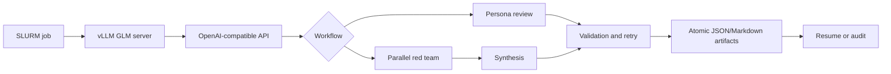

# GLM Research Review

A reproducible workflow for serving GLM-5.2/5.3 on a SLURM cluster and using the models for multi-perspective paper review, pre-experiment red-teaming, and self-consistency synthesis.

The project grew out of research triage across multilingual NLP projects. It separates model serving from orchestration: vLLM exposes an OpenAI-compatible API on an eight-GPU compute node, while lightweight Python clients coordinate parallel reviewer personas, validate responses, persist intermediate artifacts, retry incomplete work, and synthesize independent judgments.

## What it demonstrates

- Distributed GLM-5.2/5.3 serving with vLLM, tensor parallelism, long-context inference, FP8 KV cache, and optional speculative decoding.
- Ten independently prompted reviewer roles, including experimental-design, statistics, reproducibility, related-work, overclaiming, clarity, and numerical-consistency review.
- Conditional retry routing when a response is null, truncated, or missing required sections.
- Resumable execution: every completed review is written independently and skipped on later runs.
- Self-consistency red-teaming with multiple independent samples, followed by a separate synthesis pass that distinguishes convergent findings from single-sample claims.
- OpenAI-compatible HTTP inference with readiness polling, configurable timeouts, and optional bearer authentication.
- Unit tests for request construction, response validation, routing, and persisted state.
- GitHub Actions CI across Python 3.10–3.12.

## Architecture



## What this is—and is not

This is a model-orchestration workflow with independently callable review, red-team, validation, and synthesis components. Conditional routing is implemented in ordinary Python, and state is persisted to the filesystem. The original experiments did **not** use LangChain, LangGraph, AutoGen, CrewAI, long-term user memory, or autonomous external-tool selection. The model was invoked through a controlled API pipeline rather than being allowed to choose arbitrary tools.

## Quick start

Create an environment and install the package:

```bash
python -m venv .venv
source .venv/bin/activate
pip install -e '.[dev]'
```

Start any OpenAI-compatible chat-completions server, or adapt the included SLURM template:

```bash
cp slurm/serve_glm.sbatch.example slurm/serve_glm.sbatch
# Edit account, partition, model directory, and model name.
sbatch slurm/serve_glm.sbatch
```

Set the endpoint and run a review:

```bash
export GLM_BASE_URL=http://compute-node:8000
export GLM_MODEL=glm-5.3

glm-review \
  --papers examples/papers.example.json \
  --output outputs/reviews
```

Run independent red-team samples and synthesize them:

```bash
glm-red-team \
  --questions examples/questions.example.json \
  --output outputs/red-team \
  --samples 8

glm-synthesize \
  --input outputs/red-team \
  --questions examples/questions.example.json \
  --output outputs/synthesis
```

An API key is optional for a trusted internal vLLM endpoint. For authenticated servers, set `GLM_API_KEY`; it is read from the environment and never written to output files.

## Configuration

Common environment variables:

| Variable | Default | Purpose |
|---|---:|---|
| `GLM_BASE_URL` | `http://127.0.0.1:8000` | OpenAI-compatible server root |
| `GLM_MODEL` | `glm-5.3` | Served model name |
| `GLM_API_KEY` | unset | Optional bearer token |
| `GLM_TIMEOUT` | `1800` | Request timeout in seconds |

The CLI flags control sampling temperature, output-token budget, reasoning effort, personas, overwrite behavior, and readiness polling.

## Repository layout

```text
src/glm_review/
  client.py       OpenAI-compatible HTTP client
  personas.py     Reviewer definitions and output contract
  review.py       Resumable multi-persona paper review
  red_team.py     Independent pre-experiment critiques
  synthesis.py    Cross-sample convergence analysis
  storage.py      Atomic JSONL and Markdown persistence
slurm/             Sanitized cluster templates
examples/          Public-safe configuration examples
tests/             Offline unit tests
.github/workflows/ Continuous integration
```

## Tests

The tests are offline and do not require model weights or a GPU:

```bash
pytest --cov=glm_review --cov-report=term-missing
```

## Public-release notes

Model weights, unpublished manuscripts, generated reviews, SLURM logs, node names, user-specific filesystem paths, and credentials are intentionally excluded. Download GLM weights from the model provider under the applicable model license.

## License

The orchestration code in this repository is released under the MIT License. Model weights remain subject to their provider's license.
